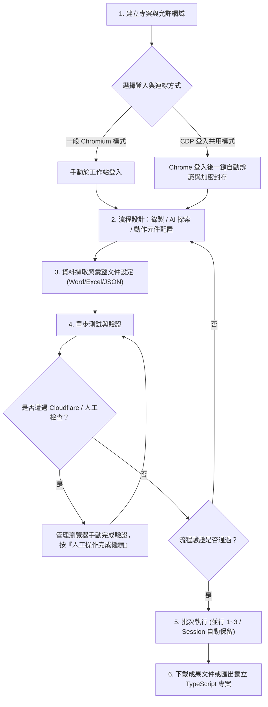

# 網站自動化流程設計平台 · Automation Studio (Portable v2.2.4)

[](https://github.com/chiang-hz/automation-studio-generic-portable)
[](VERSION)
[-brightgreen.svg)](scripts/portable-runtime-packages.json)
[](https://playwright.dev)

**Automation Studio** 是一套專為 Windows 環境打造的本機視覺化網頁自動化流程設計、錄製、除錯與批次執行平台。結合 **Playwright** 瀏覽器自動化引擎、**React 19** 現代化視覺操作介面、**AI 流程探索助理** 以及 **Model Context Protocol (MCP)** 服務架構，協助使用者以低代碼方式快速建立穩定、可維護的網頁資料擷取與自動化作業流程。

在最新的 **v2.2.x** 版本中，平台迎來三項核心功能升級：
1. **網頁資料擷取與原生彙整文件產製（v2.2.0）**：原生支援從單頁、重複清單或 HTML 表格擷取結構化資料，並以純本機 Open XML 原生輸出為 **Word (`.docx`)**、**Excel (`.xlsx`)** 或 **JSON (`.json`)**，免安裝 Office 亦無外部套件依賴。
2. **CDP 登入狀態安全共用與免技術自動辨識（v2.2.1～v2.2.3）**：採用 **AES-256-GCM + scrypt** 安全保管本機 Chrome 登入狀態，支援非資訊人員一鍵列出分頁並自動辨識專屬登入元素，免手動輸入網址或 CSS。
3. **管理瀏覽器人工驗證恢復與批次工作階段保留（v2.2.4）**：遇到網站二次認證或 Cloudflare 人工安全檢查時自動暫停，人員完成驗證後一鍵繼續；同一批次工作站自動保留驗證後的 Session，兼顧合規安全與大量作業效率。

本倉庫為 **Windows 可攜版（Portable Edition）**，無須在作業系統預先安裝 Node.js 或建置全域環境，開箱即可透過獨立執行檔一鍵初始化與啟動。

---

## 目錄

- [一、快速開始](#一快速開始)
  - [系統需求](#系統需求)
  - [首次初始化與環境修復](#首次初始化與環境修復)
  - [啟動與停止](#啟動與停止)
  - [環境設定與公司憑證](#環境設定與公司憑證)
- [二、核心功能特色](#二核心功能特色)
  - [1. 專業 IDE 工具列與現代化設計器](#1-專業-ide-工具列與現代化設計器)
  - [2. 瀏覽器工作站與三種連線模式](#2-瀏覽器工作站與三種連線模式)
  - [3. 豐富動作元件、原生 PDF 與定期自動重新整理](#3-豐富動作元件原生-pdf-與定期自動重新整理)
  - [4. 【全新】網頁資料擷取與原生彙整文件產製 (Word / Excel / JSON)](#4-全新網頁資料擷取與原生彙整文件產製-word--excel--json)
  - [5. 【全新】CDP 登入狀態安全共用與免技術自動辨識](#5-全新cdp-登入狀態安全共用與免技術自動辨識)
  - [6. 【全新】管理瀏覽器人工驗證恢復與 Cloudflare 暫停機制](#6-全新管理瀏覽器人工驗證恢復與-cloudflare-暫停機制)
  - [7. 批次任務與 1–3 筆多工並行隔離](#7-批次任務與-13-筆多工並行隔離)
  - [8. AI 流程助理與站台探索 (Site Explorer)](#8-ai-流程助理與站台探索-site-explorer)
  - [9. 單步測試、除錯與執行紀錄管理](#9-單步測試除錯與執行紀錄管理)
  - [10. 專案匯入、成果匯出與發布](#10-專案匯入成果匯出與發布)
  - [11. Playwright MCP 工具與相容模組](#11-playwright-mcp-工具與相容模組)
- [三、建議標準操作流程](#三建議標準操作流程)
- [四、重要注意事項與最佳實踐](#四重要注意事項與最佳實踐)
- [五、目錄架構與檔案儲存](#五目錄架構與檔案儲存)
- [六、開發與建置說明](#六開發與建置說明)

---

## 一、快速開始

### 系統需求
- **作業系統**：Windows 10 / Windows 11 (64-bit)
- **網路環境**：具備網際網路連線以利首次下載執行環境；支援企業內部網路與自訂 CA 憑證。
- **系統工具**：Windows 內建之 `curl.exe`、`certutil.exe` 與 `tar.exe`。

### 首次初始化與環境修復

本可攜包為了保持檔案精簡，排除了龐大的 `node.exe` 與 Chromium 瀏覽器二進位檔。**首次使用或剛從 GitHub Clone 專案時**，請先依下列步驟初始化：

1. 雙擊執行根目錄的 **`setup-runtime.bat`**。
2. 腳本會自動以 Windows 系統信任庫下載固定版本的 Node.js（v24.13.0 x64），並經由 **SHA-256 強制雜湊校驗** 確保檔案安全性。
3. 隨後自動驗證依賴套件並下載 Playwright Chromium 瀏覽器至 `runtime\browsers\`。
4. 當畫面出現 `[Setup] Runtime is ready` 即代表安裝完成。

> [!NOTE]
> **更新既有安裝**：解壓縮新版本覆蓋時，可保留原本的 `runtime\node\node.exe` 與 `runtime\browsers\`，直接執行 `start.bat` 即可啟動。

### 啟動與停止

1. **啟動平台**：
   - 雙擊執行根目錄的 **`start.bat`**。
   - 系統在啟動本機伺服器完成後，會**自動在預設瀏覽器開啟操作介面**：`http://127.0.0.1:4173`。
2. **停止平台**：
   - 雙擊執行根目錄的 **`stop.bat`**，即可安全終止所有背景執行的 Studio 伺服器程序。

### 環境設定與公司憑證

若需自訂連接埠或設定 AI API 金鑰，可複製 `.env.example` 為 `.env` 進行微調：

```ini
# 服務連接埠（預設 4173）
UI_PORT=4173

# 預設檔案下載儲存路徑
DOWNLOAD_DIR=./downloads

# AI 服務供應商金鑰（可選，亦可於介面設定中填入）
GEMINI_API_KEY=
OPENAI_API_KEY=
```

> [!TIP]
> **企業內部網路與 SSL 憑證檢查說明**：
> `start.bat` 與 `setup-runtime.bat` 預設啟用 `NODE_USE_SYSTEM_CA=1`，讓 Node.js 與 Playwright 自動讀取 Windows 系統憑證庫，避免企業防火牆 SSL 檢驗產生 `unable to get local issuer certificate` 錯誤。若有獨立的根憑證鏈檔案，可在啟動前設定環境變數 `NODE_EXTRA_CA_CERTS=C:\path\to\company-ca-chain.pem`。

---

## 二、核心功能特色

### 1. 專業 IDE 工具列與現代化設計器
- **單行緊湊 IDE 工具列**：整合格致的工作區導覽、即時執行狀態指示與快捷功能選單。
- **單擊選取 / 雙擊開啟**：畫布與階層清單支援單擊選取步驟、雙擊開啟右側抽屜式詳細屬性面板；面板不遮擋背景畫布，便於即時對照。
- **拖曳排序精準插入**：支援同層步驟拖曳，依卡片上緣（向前插入）、中央（交換位置）、下緣（向後插入）精準調整順序。
- **動作元件 5 大功能分類**：支援關鍵字即時篩選與插入對話框搜尋，快速定位所需的網頁操作動作。
- **條件分支獨立收折與記憶**：True / False 分支與迴圈區塊可個別收折，顯示內部步驟數量，並透過瀏覽器端本機儲存保留收折狀態。

### 2. 瀏覽器工作站與三種連線模式
- **隨附 Chromium（建議模式）**：
  - 獨立瀏覽器執行環境，支援「**持久化設定檔（Profile）**」，登入狀態、Session Storage 與 Cookie 會完整留存本機。
  - 內建「**Stealth 反偵測**」外掛，能有效繞過大部分 Cloudflare 或常見 Bot 偵測機制。
- **接管現有 Chrome（CDP 模式）**：
  - 透過 Chrome DevTools Protocol（預設埠 `9222`）連線至日常運行的 Chrome。
  - 直接共用現有書籤、已登入帳號及特定企業憑證；可透過根目錄的 `start-chrome-cdp.bat` 快速開啟專用除錯視窗。
- **背景無頭模式 (Headless)**：
  - 無介面高速背景運行，適合伺服器常駐或無干擾批次作業。

### 3. 豐富動作元件、原生 PDF 與定期自動重新整理
- **標準網頁互動**：點擊、雙擊、輸入文字、下拉選單選取、單選/複選框、鍵盤快捷鍵、檔案上傳。
- **資料擷取與剪貼簿**：
  - 擷取文字/屬性至變數 `{{varName}}`。
  - 正則表達式（Regex）提取關鍵代碼或金額。
  - 動態變數複製到系統剪貼簿供跨頁操作使用。
- **原生 Chromium「保存頁面 PDF」**：
  - 調用瀏覽器底層 Direct Print API，無需仰賴網頁額外列印按鈕。
  - 支援 A4/Letter 紙張、橫向/直向、邊距設定（mm）、10%–200% 縮放比例及自訂 HTML 頁首/頁尾範本。
- **等待新資料：定期重新整理 (Periodic Refresh)**：
  - 在「等待清單新資料」與「等待第一筆新資料」步驟中，新增「**定期重新整理**」功能與間隔秒數設定（5～600 秒，預設 10 秒）。
  - 啟用後系統將按指定間隔自動重新載入頁面，同時完整保留既有已擷取清單作為基準比對快照，一旦出現新資料即自動繼續。
- **人工操作等待步驟 (Human-in-the-Loop)**：
  - 遇到簡訊 OTP、驗證碼或硬體憑證時流程自動暫停，支援手動確認、特定元素出現或網址變更三種自動繼續條件。

### 4. 【全新】網頁資料擷取與原生彙整文件產製 (Word / Excel / JSON)
- **擷取網頁資料 (`extractWebData` 動作元件)**：
  - **三種擷取模式**：
    - **單頁欄位 (`single`)**：從當前頁面擷取指定的多個獨立欄位。
    - **重複清單 (`list`)**：指定列表列的容器 Selector，自動逐列遍歷擷取內部各欄位資訊。
    - **HTML 表格 (`table`)**：自動分析 `<table>` 的表頭與每一列單元格內容並轉化為結構化欄位。
  - **靈活欄位擷取模式**：各欄位支援純文字內容 (`text`)、原始 HTML (`html`) 或特定屬性 (`attribute`，如連結 `href`、圖片 `src` 等)。
  - **資料集合管理**：支援將資料**追加 (`append`)** 至現有命名集合或**取代 (`replace`)** 集合；自動記錄抓取來源網址 (`sourceUrl`) 與時間戳記 (`extractedAt`)。
  - **容量與限制保護**：單次最多擷取 5,000 筆，整趟流程集合上限 50,000 筆，保障執行效能與記憶體穩定。
- **保存彙整文件 (`saveDocument` 動作元件)**：
  - **三大標準匯出格式**：
    - **Word (`.docx`)**：支援排版為標準表格 (`table`) 或逐筆段落清單 (`paragraphs`)。
    - **Excel (`.xlsx`)**：標準試算表，自動建立表頭列與純文字資料儲存格，支援自訂工作表名稱 (`sheetName`)。
    - **結構化 JSON (`.json`)**：匯出結構完整的 JSON 資料陣列，便於後續系統介接。
  - **零依賴本機 Open XML 原生產生**：後端採用本機 Open XML/ZIP 結構化封裝技術，**使用者的電腦完全不需要安裝 Microsoft Office，亦無須連線至外部轉換服務或載入重量級套件**，產製快速且安全無虞。
  - **彈性客製**：支援自訂輸出欄位順序、欄位顯示標題名稱對應，以及本地時區防覆寫時間戳記檔名。
  - **自動追蹤與獨立執行**：產製的文件自動輸出至下載目錄並登記於執行紀錄成果清單；匯出獨立 TypeScript 時亦包含完整產檔支援。
  - **隨附範例**：根目錄 `examples/web-data-documents-example-1.0.0.zip` 提供即匯即用的資料擷取與文件產製範本。

### 5. 【全新】CDP 登入狀態安全共用與免技術自動辨識
- **CDP 登入狀態安全封存 (Auth State Vault)**：
  - **解決痛點**：企業或政府內部系統常包含複雜的多因素驗證 (MFA) 或圖形驗證碼，管理瀏覽器重啟時往往需重新登入。
  - **工作原理**：使用者在日常已開啟的 Chrome (CDP 模式) 完成手動登入後，系統透過 CDP 安全導出該站台的 Storage State（包含 Cookies 與 LocalStorage）。
  - **軍規級加密保存**：採用 **AES-256-GCM** 與 **scrypt** 衍生金鑰，依專案識別碼與 HTTPS origin 獨立加密保存於本機 `%LOCALAPPDATA%\AutomationStudio\private-auth-vault`。
  - **機敏資訊零外洩**：自訂密語（至少 16 字元）僅於 Node 程序記憶體中保留最多 1 小時，Vault 最長保存 8~24 小時。密語與 Cookie 絕不寫入工作流程 JSON、絕不進入成果 ZIP、亦不會輸出至失敗診斷包。
- **非資訊人員免技術自動辨識 (Zero-Code Auto-Detection)**：
  - **一鍵列出分頁**：直接讀取 Chrome 在專案允許網域中已開啟的所有網頁，使用者直接選取登入後的管理頁面，**完全不需要手動複製或輸入網址**（系統會自動過濾 OAuth 回呼頁、SSO 登入頁與網址敏感 Token/Hash）。
  - **雙重辨識機制**：
    - **自動辨識**：自動掃描網頁 DOM，分析僅在登入狀態下呈現的特徵標記。
    - **在 Chrome 點選專屬項目**：提供直覺式備援，切換至 Chrome 視窗後直接以滑鼠點選「使用者姓名」、「登出按鈕」或管理功能，系統自動產生對應之 CSS Selector。
  - **智慧未登入對照驗證**：系統會同步啟動一個完全無 Cookie 的獨立背景對照頁進行雙向驗證，**只有「登入後看得到、未登入看不到」的特徵元素才能通過辨識**，杜絕以公開頁面元素誤判登入成功的風險。
  - **進階技術設定預設收折**：檢查網址與 CSS 規則由系統自動代入，原始技術欄位收納於進階區塊，對一般業務同仁極度友善。
  - **隨附即用面板**：內建透過獨立 `public/auth-state-panel.js` 提供完整的登入狀態管理面板，開箱即可使用。

### 6. 【全新】管理瀏覽器人工驗證恢復與 Cloudflare 暫停機制
- **Cloudflare / 人工安全檢查自動暫停與恢復**：
  - 當管理瀏覽器載入加密 Storage State 後，若網站依然要求二次驗證或觸發 Cloudflare Turnstile / 人工安全檢查：
    - **有頭模式 (Headed)**：任務**自動暫停**，執行狀態切換為「等待人工操作」，管理瀏覽器視窗彈出至前景，提示使用者在畫面上親自點選完成真人驗證。
    - **一鍵繼續執行**：使用者手動完成驗證後，返回 Studio 點擊「**人工操作完成，繼續執行**」，系統將自動再次導向檢查網址驗證專屬元素，確認驗證通過後無縫接續後續自動化步驟。
    - **合規安全原則**：**本平台絕不嘗試暴力破解或自動繞過 Cloudflare / CAPTCHA**，嚴格確保所有真人驗證均在使用者監督下合法合規完成。
    - **無頭模式安全防護**：若在無頭模式 (Headless) 下遇到驗證失敗，系統會立即安全中斷並明確回報錯誤代碼 `AUTH_INVALID`，絕不進行盲目假等待。
- **批次工作站 Session 保留 (Batch Context Preservation)**：
  - 批次執行多筆任務時，同一工作站 Worker 會**持續保留已由使用者完成驗證的 BrowserContext**，後續同工作站的任務直接重用該 Session，大幅降低重複手動驗證的困擾。
  - 每次重用前自動執行登入健康檢查；若網站 Session 到期失效，系統會立即安全取消同專案排隊中的剩餘任務，防止無效空轉。
  - 批次下載成果自動隔離存放至每筆獨立的子目錄 `downloads/auth-batch/<run-id>`，避免多工衝突。

### 7. 批次任務與 1–3 筆多工並行隔離
- **結構化資料匯入/匯出**：
  - 支援 **JSON** 與 **UTF-8 CSV（含 BOM）**，Excel 開啟不亂碼。
  - 支援清單批次選取、一鍵全選/取消，機敏密碼參數預設不導出。
- **多工並行 (Concurrency 1–3)**：
  - 可設定並行數 1、2 或 3。
  - 每個 Worker 採用**獨立瀏覽器 Profile 目錄隔離**或**獨立 BrowserContext**，各 Session 互不影響。
  - 下載檔案採用原子鎖定預留檔名，啟用共用登入時自動分流至 `downloads/auth-batch/<run-id>` 專屬目錄。

### 8. AI 流程助理與站台探索 (Site Explorer)
- **真實現存 DOM 探索**：AI 助理在生成步驟前，先以可見瀏覽器載入目標網頁，探索頁面階層與真實元素。
- **零幻覺保證**：僅允許挑選當前 DOM 實際存在的 selector，杜絕虛構元素導致的執行失敗。
- **修訂與視覺差異比對**：支援多輪對話調整流程，介面以紅/綠/黃色高亮標示新增、刪除與修改步驟。
- **多模型支援**：支援 Google Gemini、OpenAI、Ollama（本機離線大模型）以及自訂 OpenAI 相容 Gateway。

### 9. 單步測試、除錯與執行紀錄管理
- **單步與局部除錯**：支援「只執行此步驟」與「從此步驟執行」，省去反覆登入前置動作的時間。
- **即時監控與 AI 失敗診斷**：流程出錯時，AI 會主動解析最後截圖、DOM 結構與 Console Log，提供精準修復建議。
- **執行紀錄 (Runs)**：獨立紀錄清單，保留每次任務步驟耗時、快照、下載檔案及一鍵下載「失敗診斷包 ZIP」。
- **自動清理機制**：支援設定資料保留天數，定時清理舊快照以保護硬碟容量。

### 10. 專案匯入、成果匯出與發布
- **專案匯入 UUID 隔離**：匯入專案時自動以固定長度 UUID 生成全新專案識別碼，徹底解決歷史版本附加時間戳記導致識別碼過長的問題。
- **匯出多元發布格式**：
  - **可攜工作流程 ZIP**：供不同 Studio 主機間匯入共用。
  - **獨立 TypeScript 專案**：導出完整的 Node.js + Playwright 腳本（內含原生 Word/Excel 產檔與資料擷取邏輯），可脫離 Studio 獨立排程執行。
  - **Agent `SKILL.md` 規格**：可作為 Claude、Gemini 或其他 AI Agent 呼叫的自動化工具規格。

### 11. Playwright MCP 工具與相容模組
- **標準 MCP 伺服器**：位於 [src/mcp/server.ts](src/mcp/server.ts)，對外提供任務型工具介面（建立下載任務、查詢下載狀態、取得結果）。
- **EBAS 相容模組**：預算報表模組保留於 `/legacy/` 路徑，可透過 `start-ebas-ui.bat` 獨立啟動。

---

## 三、建議標準操作流程



1. **建立專案**：在專案總覽點擊新增專案，填入專案名稱、起始網址與允許網域（Allowlist）。
2. **登入準備**：
   - *一般模式*：至「網站與工作站」啟動隨附 Chromium 完成網站登入。
   - *CDP 共用模式*：使用日常 Chrome 登入後，至「登入狀態共用」點選分頁並點擊「**自動辨識**」，輸入密語加密保存；於管理瀏覽器啟用保存狀態並解鎖。
3. **流程設計**：使用錄製器記錄操作，或使用 AI 探索自動生成步驟。
4. **資料擷取與產檔**：
   - 加入「**擷取網頁資料**」步驟（選取清單/表格、欄位、追加至集合）。
   - 加入「**保存彙整文件**」步驟（選擇 Word/Excel/JSON、欄位標題與檔案名稱）。
5. **單步測試與驗證**：
   - 透過「只執行此步驟」驗證 Selector 正確性。
   - 若管理瀏覽器遇到 Cloudflare 人工驗證，於開啟的視窗中手動點選完成，再回平台按「**人工操作完成，繼續執行**」。
6. **批次執行**：於「批次任務」匯入 CSV/JSON 資料，設定並行數 1–3 進行大量自動化抓取；同工作站將自動沿用已驗證 Session。
7. **發布成果**：於「執行紀錄」下載產製的 Word/Excel/JSON 文件，或至「發布與版本」下載獨立 TypeScript 專案排程運行。

---

## 四、重要注意事項與最佳實踐

1. **驗證碼 (CAPTCHA) 與 Cloudflare 安全驗證**：
   - 請勿嘗試使用自動化腳本暴力破解圖形驗證碼或 Cloudflare，極易導致 IP 被封禁。
   - **最佳實踐**：平台已內建「**人工操作恢復機制**」與「**等待人工操作**」步驟。遇到安全挑戰時系統自動暫停，由人員於管理視窗完成驗證後再按繼續，兼顧安全性與作業連續性。
2. **登入狀態共用之安全規範**：
   - 加密 Vault 採用 **AES-256-GCM + scrypt** 保管，請設定至少 16 字元的強密語。
   - 密語與解鎖狀態僅保留於記憶體最長 1 小時，且絕不寫入工作流程或匯出檔案中。
   - 僅允許對專案允許網域的 HTTPS 網站進行狀態共用。
3. **網頁資料擷取與彙整文件最佳實踐**：
   - 擷取重複清單時，請確保列 Selector (Row Selector) 具備唯一性與穩定性。
   - 單次擷取筆數建議控制在 5,000 筆以內，整趟流程建議不超過 50,000 筆。
   - 產製之 Word (`.docx`) 與 Excel (`.xlsx`) 為標準本機 Open XML 結構，相容於 Microsoft Office、WPS Office 與 LibreOffice。
4. **機敏資訊保護**：
   - 帳號密碼等資料請在「參數管理」中標記為「**機敏參數**」。機敏參數不會寫入一般日誌，匯出時自動清空。
5. **請求頻率與防封鎖策略**：
   - 避免將步驟間延遲設為 0；預設每步 800ms 能維持穩定互動。
   - 目標網站若有單一帳號連線限制，請保持「同時執行數 = 1」，切勿冒然開啟高並行。
6. **企業網路憑證**：
   - 若遇到 SSL 檢驗失敗，請確認是否已透過系統 CA 信任庫運作（`NODE_USE_SYSTEM_CA=1`），切勿在正式環境關閉 TLS 驗證。

---

## 五、目錄架構與檔案儲存

```text
automation-studio-generic-portable/
├── setup-runtime.bat                      # 首次環境初始化腳本（下載 Node.js 與 Playwright）
├── start.bat                              # 快速啟動批次檔
├── stop.bat                               # 停止服務批次檔
├── start-chrome-cdp.bat                   # 啟動日常 Chrome CDP 除錯視窗
├── start-ebas-ui.bat                      # 啟動 EBAS 舊版相容介面
├── PORTABLE-WINDOWS.md                    # 可攜版執行與網路修復指南
├── VERSION                                # 系統版本標記檔 (2.2.4)
├── VERSIONING.md                          # 版本號規範與里程碑說明
├── CHANGELOG.md                           # 集中版本變更歷史紀錄
├── AGENTS.md                              # Playwright MCP 架構助手角色規範
├── AUTH-STATE-AUTO-DETECT-README.zh-TW.md # 登入狀態免技術自動辨識說明
├── AUTH-STATE-MANAGED-RECOVERY-README.zh-TW.md # 管理瀏覽器人工驗證恢復說明
├── AUTH-STATE-REUSE-README.zh-TW.md       # CDP 登入狀態共用技術說明
├── examples/                              # 範例自動化專案包
│   └── web-data-documents-example-1.0.0.zip # 網頁資料擷取與文件產製範例
├── src/                                   # 後端核心、MCP 伺服器與 Playwright 執行引擎
│   ├── adapters/                          # 瀏覽器與報表介面適配器
│   ├── domain/                            # 領域模型與型別定義
│   ├── mcp/                               # Model Context Protocol 工具伺服器
│   ├── studio/                            # 工作站、AI 探索、錄製、資料擷取與執行核心
│   │   ├── authSessions.ts                # 加密登入狀態保管庫 (Vault)
│   │   ├── managedAuthRecovery.ts         # 管理瀏覽器人工驗證暫停與恢復
│   │   └── webData.ts                     # 網頁資料擷取與 Word/Excel/JSON 原生產製
│   └── ui/                                # 本機 HTTP 與 WebSocket 伺服器
├── frontend/                              # React 19 SPA 前端原始碼
├── public/                                # 前端建置產物與 Monaco Editor 資源
│   ├── auth-state-panel.js                # 登入狀態共用與自動辨識面板（離線即用）
│   └── modern/                            # 前端最新版 SPA 產物
├── scripts/                               # 離線環境建置與可攜包配置腳本
├── data/
│   ├── profiles/                          # 瀏覽器持久化 Cookie / Session 資料
│   └── studio/                            # 專案定義與歷史執行紀錄 (JSON)
├── downloads/                             # 自動化下載產物儲存目錄
│   └── auth-batch/                        # 登入共用模式批次下載隔離目錄
├── debug/                                 # 失敗快照、截圖與診斷包儲存目錄
└── runtime/                               # 本機專屬可攜執行環境（不進入 Git）
    ├── node/                              # 固定版本之 Node.js 執行檔 (v24.13.0)
    └── browsers/                          # Playwright Chromium 瀏覽器快取
```

---

## 六、開發與建置說明

如需修改原始碼或進行二次開發：

### 前端 React SPA 建置
```bash
# 1. 前端 TypeScript 型別檢查
npm run frontend:check

# 2. 建置前端 SPA 產物並發布至 public/modern
npm run frontend:build

# 3. 完整專案語法與型別檢查
npm run check:all
```

### 測試執行
```bash
# 執行單元與整合測試
npm test
```

---

*網站自動化流程設計平台 · Automation Studio (Portable Edition)*

