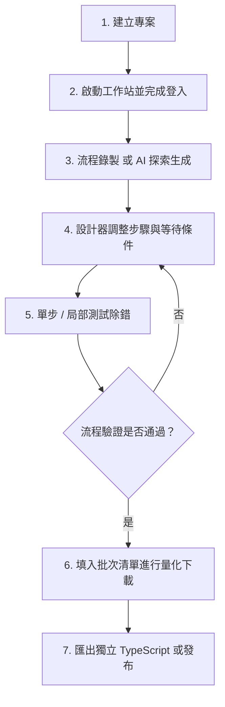

# 網站自動化流程設計平台 · Automation Studio (Portable v2.1.0)

[](https://github.com/chiang-hz/automation-studio-generic-portable)
[](VERSION)
[-brightgreen.svg)](scripts/portable-runtime-packages.json)
[](https://playwright.dev)

**Automation Studio** 是一套專為 Windows 環境打造的本機視覺化網頁自動化流程設計、錄製、除錯與批次執行平台。結合 **Playwright** 瀏覽器自動化引擎、**React 19** 現代化視覺操作介面、**AI 流程探索助理** 以及 **Model Context Protocol (MCP)** 服務架構，協助使用者以低代碼方式快速建立穩定、可維護的網頁資料擷取與自動化作業流程。

本倉庫為 **Windows 可攜版（Portable Edition）**，無須在作業系統預先安裝 Node.js 或建置全域環境，開箱即可透過獨立執行檔一鍵初始化與啟動。

---

## 目錄

- [一、快速開始](#一快速開始)
  - [系統需求](#系統需求)
  - [首次初始化與環境修復](#首次初始化與環境修復)
  - [啟動與停止](#啟動與停止)
  - [環境設定與公司憑證](#環境設定與公司憑證)
- [二、核心功能特色](#二核心功能特色)
  - [1. 專業 IDE 工具列與現代化設計器](#1-專業-ide-工具列與現代化設計器)
  - [2. 瀏覽器工作站與三種連線模式](#2-瀏覽器工作站與三種連線模式)
  - [3. 豐富動作元件與原生 PDF 產製](#3-豐富動作元件與原生-pdf-產製)
  - [4. 批次任務與 1–3 筆多工並行隔離](#4-批次任務與-13-筆多工並行隔離)
  - [5. AI 流程助理與站台探索 (Site Explorer)](#5-ai-流程助理與站台探索-site-explorer)
  - [6. 單步測試、除錯與執行紀錄](#6-單步測試除錯與執行紀錄)
  - [7. 專案匯入、成果匯出與發布](#7-專案匯入成果匯出與發布)
  - [8. Playwright MCP 工具與相容模組](#8-playwright-mcp-工具與相容模組)
- [三、建議標準操作流程](#三建議標準操作流程)
- [四、重要注意事項與最佳實踐](#四重要注意事項與最佳實踐)
- [五、目錄架構與檔案儲存](#五目錄架構與檔案儲存)
- [六、開發與建置說明](#六開發與建置說明)

---

## 一、快速開始

### 系統需求
- **作業系統**：Windows 10 / Windows 11 (64-bit)
- **網路環境**：具備網際網路連線以利首次下載執行環境；支援企業內部網路與自訂 CA 憑證。
- **系統工具**：Windows 內建之 `curl.exe`、`certutil.exe` 與 `tar.exe`。

### 首次初始化與環境修復

本可攜包為了保持檔案精簡，排除了龐大的 `node.exe` 與 Chromium 瀏覽器二進位檔。**首次使用或剛從 GitHub Clone 專案時**，請先依下列步驟初始化：

1. 雙擊執行根目錄的 **`setup-runtime.bat`**。
2. 腳本會自動以 Windows 系統信任庫下載固定版本的 Node.js（v24.13.0 x64），並經由 **SHA-256 強制雜湊校驗** 確保檔案安全性。
3. 隨後自動驗證依賴套件並下載 Playwright Chromium 瀏覽器至 `runtime\browsers\`。
4. 當畫面出現 `[Setup] Runtime is ready` 即代表安裝完成。

> [!NOTE]
> **更新既有安裝**：解壓縮新版本覆蓋時，可保留原本的 `runtime\node\node.exe` 與 `runtime\browsers\`，直接執行 `start.bat` 即可啟動。

### 啟動與停止

1. **啟動平台**：
   - 雙擊執行根目錄的 **`start.bat`**。
   - 系統在啟動本機伺服器完成後，會**自動在預設瀏覽器開啟操作介面**：`http://127.0.0.1:4173`。
2. **停止平台**：
   - 雙擊執行根目錄的 **`stop.bat`**，即可安全終止所有背景執行的 Studio 伺服器程序。

### 環境設定與公司憑證

若需自訂連接埠或設定 AI API 金鑰，可複製 `.env.example` 為 `.env` 進行微調：

```ini
# 服務連接埠（預設 4173）
UI_PORT=4173

# 預設檔案下載儲存路徑
DOWNLOAD_DIR=./downloads

# AI 服務供應商金鑰（可選，亦可於介面設定中填入）
GEMINI_API_KEY=
OPENAI_API_KEY=
```

> [!TIP]
> **企業內部網路與 SSL 憑證檢查說明**：
> `start.bat` 與 `setup-runtime.bat` 預設啟用 `NODE_USE_SYSTEM_CA=1`，讓 Node.js 與 Playwright 自動讀取 Windows 系統憑證庫，避免企業防火牆 SSL 檢驗產生 `unable to get local issuer certificate` 錯誤。若有獨立的根憑證鏈檔案，可在啟動前設定環境變數 `NODE_EXTRA_CA_CERTS=C:\path\to\company-ca-chain.pem`。

---

## 二、核心功能特色

### 1. 專業 IDE 工具列與現代化設計器
- **單行緊湊 IDE 工具列**：整合格致的工作區導覽、即時執行狀態指示與快捷功能選單。
- **單擊選取 / 雙擊開啟**：畫布與階層清單支援單擊選取步驟、雙擊開啟右側抽屜式詳細屬性面板；面板不遮擋背景畫布，便於即時對照。
- **拖曳排序精準插入**：支援同層步驟拖曳，依卡片上緣（向前插入）、中央（交換位置）、下緣（向後插入）精準調整順序。
- **動作元件 5 大功能分類**：支援關鍵字即時篩選與插入對話框搜尋，快速定位所需的網頁操作動作。
- **條件分支獨立收折**：True / False 分支與迴圈區塊可個別收折，並顯示內部步驟數量。

### 2. 瀏覽器工作站與三種連線模式
- **隨附 Chromium（建議模式）**：
  - 獨立瀏覽器執行環境，支援「**持久化設定檔（Profile）**」，登入狀態、Session Storage 與 Cookie 會完整留存本機。
  - 內建「**Stealth 反偵測**」外掛，能有效繞過大部分 Cloudflare 或常見 Bot 偵測機制。
- **接管現有 Chrome（CDP 模式）**：
  - 透過 Chrome DevTools Protocol（預設埠 `9222`）連線至日常運行的 Chrome。
  - 直接共用現有書籤、已登入帳號及特定企業憑證；可透過根目錄的 `start-chrome-cdp.bat` 快速開啟專用除錯視窗。
- **背景無頭模式 (Headless)**：
  - 無介面高速背景運行，適合伺服器常駐或無干擾批次作業。

### 3. 豐富動作元件與原生 PDF 產製
- **標準網頁互動**：點擊、雙擊、輸入文字、下拉選單選取、單選/複選框、鍵盤快捷鍵。
- **資料擷取與剪貼簿**：
  - 擷取文字/屬性至變數 `{{varName}}`。
  - 正則表達式（Regex）提取關鍵代碼或金額。
  - 動態變數複製到系統剪貼簿供跨頁操作使用。
- **原生 Chromium「保存頁面 PDF」**：
  - 調用瀏覽器底層 Direct Print API，無需仰賴網頁額外列印按鈕。
  - 支援 A4/Letter 紙張、橫向/直向、邊距設定（mm）、10%–200% 縮放比例及自訂 HTML 頁首/頁尾範本。
- **人工操作等待步驟 (Human-in-the-Loop)**：
  - 遇到簡訊 OTP、驗證碼或硬體憑證時流程自動暫停，支援手動確認、特定元素出現或網址變更三種自動繼續條件。

### 4. 批次任務與 1–3 筆多工並行隔離
- **結構化資料匯入/匯出**：
  - 支援 **JSON** 與 **UTF-8 CSV（含 BOM）**，Excel 開啟不亂碼。
  - 支援清單批次選取、一鍵全選/取消，機敏密碼參數預設不導出。
- **多工並行 (Concurrency 1–3)**：
  - 可設定並行數 1、2 或 3。
  - 每個 Worker 採用**獨立瀏覽器 Profile 目錄隔離**，各 Session 互不影響。
  - 下載檔案採用原子鎖定預留檔名，避免多個 Worker 同時寫入覆蓋。

### 5. AI 流程助理與站台探索 (Site Explorer)
- **真實現存 DOM 探索**：AI 助理在生成步驟前，先以可見瀏覽器載入目標網頁，探索頁面階層與真實元素。
- **零幻覺保證**：僅允許挑選當前 DOM 實際存在的 selector，杜絕虛構元素導致的執行失敗。
- **修訂與視覺差異比對**：支援多輪對話調整流程，介面以紅/綠/黃色高亮標示新增、刪除與修改步驟。
- **多模型支援**：支援 Google Gemini、OpenAI、Ollama（本機離線大模型）以及自訂 OpenAI 相容 Gateway。

### 6. 單步測試、除錯與執行紀錄
- **單步與局部除錯**：支援「只執行此步驟」與「從此步驟執行」，省去反覆登入前置動作的時間。
- **即時監控與 AI 失敗診斷**：流程出錯時，AI 會主動解析最後截圖、DOM 結構與 Console Log，提供精準修復建議。
- **執行紀錄 (Runs)**：獨立紀錄清單，保留每次任務步驟耗時、快照、下載檔案及一鍵下載「失敗診斷包 ZIP」。
- **自動清理機制**：支援設定資料保留天數，定時清理舊快照以保護硬碟容量。

### 7. 專案匯入、成果匯出與發布
- **v2.1.0 專案匯入 UUID 隔離**：匯入專案時自動以固定長度 UUID 生成全新專案識別碼，徹底解決歷史版本附加時間戳記導致識別碼超過 120 字元的問題。
- **匯出多元發布格式**：
  - **可攜工作流程 ZIP**：供不同 Studio 主機間匯入共用。
  - **獨立 TypeScript 專案**：導出完整的 Node.js + Playwright 腳本，可脫離 Studio 獨立排程執行。
  - **Agent `SKILL.md` 規格**：可作為 Claude、Gemini 或其他 AI Agent 呼叫的自動化工具規格。

### 8. Playwright MCP 工具與相容模組
- **標準 MCP 伺服器**：位於 [src/mcp/server.ts](src/mcp/server.ts)，對外提供任務型工具介面（建立下載任務、查詢下載狀態、取得結果）。
- **EBAS 相容模組**：預算報表模組保留於 `/legacy/` 路徑，可透過 `start-ebas-ui.bat` 獨立啟動。

---

## 三、建議標準操作流程



1. **建立專案**：在專案總覽點擊新增專案，填入專案名稱與起始網址。
2. **登入準備**：至「網站與工作站」啟動隨附 Chromium，手動完成網站帳號登入與安全認證。
3. **錄製步驟**：點擊「開始錄製」，依序進行查詢、點擊、下載等操作，錄製完成後同步至設計器。
4. **精細調整**：使用設計器將動態輸入抽換為變數 `{{變數}}`，為關鍵步驟加上「等待元素」或「人工操作」中斷點。
5. **局部測試**：透過「只執行此步驟」驗證 selector 正確性。
6. **批次執行**：於「批次任務」匯入 CSV/JSON 資料，設定並行數 1–3 進行大量自動化抓取。
7. **發布成果**：至「發布與版本」下載成果 ZIP 或轉為獨立 TypeScript 專案排程執行。

---

## 四、重要注意事項與最佳實踐

1. **驗證碼 (CAPTCHA) 與多因素認證 (MFA)**：
   - 請勿使用自動化腳本暴力破解圖形驗證碼，極易導致 IP 被封禁。
   - **最佳實踐**：在流程中加入「人工操作」步驟，自動化到達該步驟會提示使用者接管完成驗證。
2. **機敏資訊保護**：
   - 帳號密碼等資料請在「參數管理」中標記為「**機敏參數**」。機敏參數不會寫入一般日誌，匯出時自動清空。
3. **請求頻率與防封鎖策略**：
   - 避免將步驟間延遲設為 0；預設每步 800ms 能維持穩定互動。
   - 目標網站若有單一帳號連線限制，請保持「同時執行數 = 1」，切勿冒然開啟高並行。
4. **企業網路憑證**：
   - 若遇到 SSL 檢驗失敗，請確認是否已透過系統 CA 信任庫運作，切勿在正式環境關閉 TLS 驗證。

---

## 五、目錄架構與檔案儲存

```text
automation-studio-generic-portable/
├── setup-runtime.bat          # 首次環境初始化腳本（下載 Node.js 與 Playwright）
├── start.bat                  # 快速啟動批次檔
├── stop.bat                   # 停止服務批次檔
├── start-chrome-cdp.bat       # 啟動日常 Chrome CDP 除錯視窗
├── start-ebas-ui.bat          # 啟動 EBAS 舊版相容介面
├── PORTABLE-WINDOWS.md        # 可攜版執行與網路修復指南
├── VERSION                    # 系統版本標記檔 (2.1.0)
├── VERSIONING.md              # 版本號規範與里程碑說明
├── CHANGELOG.md               # 集中版本變更歷史紀錄
├── AGENTS.md                  # Playwright MCP 架構助手角色規範
├── src/                       # 後端核心、MCP 伺服器與 Playwright 執行引擎
│   ├── adapters/              # 瀏覽器與報表介面適配器
│   ├── domain/                # 領域模型與型別定義
│   ├── mcp/                   # Model Context Protocol 工具伺服器
│   ├── studio/                # 工作站、AI 探索、錄製與執行核心
│   └── ui/                    # 本機 HTTP 與 WebSocket 伺服器
├── frontend/                  # React 19 SPA 前端原始碼
├── public/                    # 前端建置產物與 Monaco Editor 資源
│   └── modern/                # 前端最新版 SPA 產物
├── scripts/                   # 離線環境建置與可攜包配置腳本
├── data/
│   ├── profiles/              # 瀏覽器持久化 Cookie / Session 資料
│   └── studio/                # 專案定義與歷史執行紀錄 (JSON)
├── downloads/                 # 自動化下載產物儲存目錄
├── debug/                     # 失敗快照、截圖與診斷包儲存目錄
└── runtime/                   # 本機專屬可攜執行環境（不進入 Git）
    ├── node/                  # 固定版本之 Node.js 執行檔
    └── browsers/              # Playwright Chromium 瀏覽器快取
```

---

## 六、開發與建置說明

如需修改原始碼或進行二次開發：

### 前端 React SPA 建置
```bash
# 1. 前端 TypeScript 型別檢查
npm run frontend:check

# 2. 建置前端 SPA 產物並發布至 public/modern
npm run frontend:build

# 3. 完整專案語法與型別檢查
npm run check:all
```

### 測試執行
```bash
# 執行單元與整合測試
npm test
```

---

*網站自動化流程設計平台 · Automation Studio (Portable Edition)*
