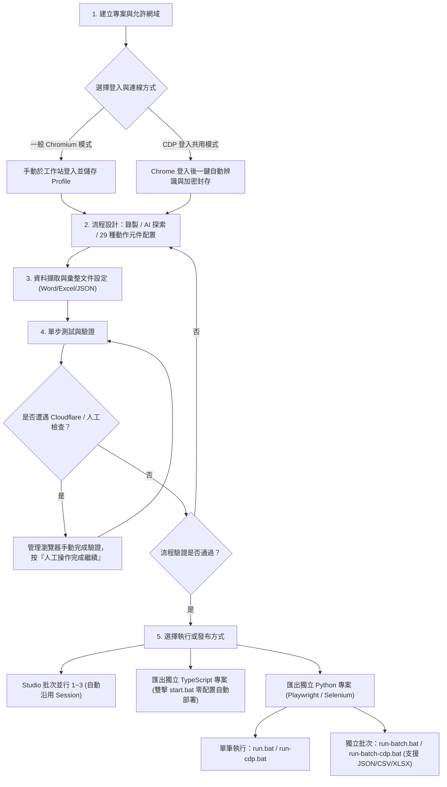

# 網站自動化流程設計平台 · Automation Studio (Portable v2.5.4)

[](https://github.com/chiang-hz/automation-studio-generic-portable)
[](VERSION)
[-brightgreen.svg)](scripts/portable-runtime-packages.json)
[](https://playwright.dev)
[-blue.svg)](PYTHON-EXPORT-README.zh-TW.md)
[](TYPESCRIPT-NODE-NPM-RECOVERY-v2.5.3.md)

**Automation Studio** 是一套專為 Windows 環境打造的本機視覺化網頁自動化流程設計、錄製、除錯、批次執行與多語言匯出發布平台。結合 **Playwright** 瀏覽器自動化引擎、**React 19** 現代化視覺操作介面、**AI 流程探索助理** 以及 **Model Context Protocol (MCP)** 服務架構，協助使用者以低代碼方式快速建立穩定、可維護的網頁資料擷取與自動化作業流程。

在 **v2.2.x ～ v2.5.x** 系列版本中，平台完成了一系列重磅企業級能力升級：
1. **網頁資料擷取與原生彙整文件產製（v2.2.0）**：原生支援從單頁、重複清單或 HTML 表格擷取結構化資料，並以純本機 Open XML 原生輸出為 **Word (`.docx`)**、**Excel (`.xlsx`)** 或 **JSON (`.json`)**，免安裝 Office 亦無外部套件依賴。
2. **CDP 登入狀態安全共用與免技術自動辨識（v2.2.1～v2.2.3, v2.5.4）**：採用 **AES-256-GCM + scrypt** 安全保管本機 Chrome 登入狀態，支援非資訊人員一鍵列出分頁並自動辨識專屬登入元素；v2.5.4 進一步將登入狀態面板預設收折，優化模式切換同步狀態與編輯鎖定保護。
3. **管理瀏覽器人工驗證恢復與批次工作階段保留（v2.2.4）**：遇到網站二次認證或 Cloudflare 人工安全檢查時自動暫停，人員完成驗證後一鍵繼續；同一批次工作站自動保留驗證後的 Session，兼顧合規安全與大量作業效率。
4. **Python 雙引擎（Playwright / Selenium）獨立專案匯出與一鍵執行（v2.3.x）**：支援一鍵匯出 **Python · Playwright** 與 **Python · Selenium** 獨立專案 ZIP；全 29 種動作元件完整相容；內建依賴自動化虛擬環境安裝（`run.bat` 自動建立 `.local/python-env`，支援 `wheelhouse/` 離線模式）；提供一鍵式 CDP 執行引導（`run-cdp.bat`）；強化 Selenium ARIA/CSS 定位與防固定導覽列遮擋置中點擊。
5. **下載真實副檔名保留、動作隔離暫存與產物安全驗證（v2.4.0～v2.4.1）**：下載重新命名時智慧保留伺服器真實副檔名、HTTP 標頭解析與 Office ZIP / 檔案特徵 Magic 偵測，檔名衝突數字自動防覆寫；Selenium 僅在下載動作期間於獨立目錄暫存捕捉並於結束後恢復預設路徑；自動檢驗攔截 Chrome 背景 CRX 元件（如偽裝為 `downloads.htm` 的模型檔）及登入/錯誤 HTML 假冒檔案，安全隔離至 `.local/download-staging/` 並標記 `[DOWNLOAD-QUARANTINE]`，杜絕污染正式下載目錄。
6. **智慧本機 Chrome 偵測免下載瀏覽器與 Windows 企業環境高容錯安裝（v2.4.2～v2.4.5）**：`setup-runtime.bat` 自動偵測電腦既有安裝的 Google Chrome，**自動跳過下載數百 MB 的 Playwright Chromium**（亦支援 `--install-bundled-browser` 強制安裝）；採用專案同磁碟暫存區消除跨磁碟機 `EXDEV` 錯誤；防毒軟體 `EPERM` 檔案鎖定自動重試與安全回滾；Windows Schannel 憑證撤銷查詢阻擋（curl 35）智慧降級重試，嚴格維持 SHA-256 與 SHA-512 雜湊驗證。
7. **Python 獨立批次任務執行與 Excel 資料格支援（v2.4.6～v2.4.8）**：匯出的 Python 專案完整支援獨立批次任務執行（`run-batch.bat` / `run-batch-cdp.bat`）；原生支援 JSON、CSV 與 **Excel (`.xlsx`)** 批次資料格輸入；循序執行、每列獨立日誌與 JSON/CSV 摘要報表；支援「失敗時繼續執行 (continue) 或停止 (stop)」錯誤策略；機敏參數遮蔽保護。
8. **【全新升級】TypeScript 獨立專案零依賴自動部署（v2.4.9～v2.5.1, v2.5.3）**：匯出的 TypeScript 專案 `start.bat` 全面進化！雙擊自動檢驗 Node.js/npm，缺少時自動下載官方固定版本 Node.js v24.13.0（含完整 npm，經 SHA-256 強校驗）解壓縮至專案內部 `runtime/node`，跳過 Chromium 下載直接使用本機 Chrome，徹底實現無痛零配置脫機自動化運行！
9. **【全新升級】跨語言匯出登入與分頁恢復一致化（v2.5.2）**：TypeScript 與 Python 匯出器同步強化！CDP 模式優先沿用同站既有分頁，遇到網站保護轉址時於當前視窗等待人工登入後自動恢復原目標路由，杜絕重複開啟多餘登入頁與無限迴圈；Selenium 點擊後智慧等待新分頁元素並安全切換，絕不重複重播具副作用的點擊。

本倉庫為 **Windows 可攜版（Portable Edition）**，無須在作業系統預先安裝 Node.js 或建置全域環境，開箱即可透過獨立執行檔一鍵初始化與啟動。

---

## 目錄

- [一、快速開始](#一快速開始)
  - [系統需求](#系統需求)
  - [首次初始化與環境修復](#首次初始化與環境修復)
  - [啟動與停止](#啟動與停止)
  - [環境設定與公司憑證](#環境設定與公司憑證)
- [二、核心功能特色](#二核心功能特色)
  - [1. 專業 IDE 工具列與現代化設計器](#1-專業-ide-工具列與現代化設計器)
  - [2. 瀏覽器工作站與三種連線模式](#2-瀏覽器工作站與三種連線模式)
  - [3. 完整 29 種動作元件、原生 PDF 與定期自動重新整理](#3-完整-29-種動作元件原生-pdf-與定期自動重新整理)
  - [4. 網頁資料擷取與原生彙整文件產製 (Word / Excel / JSON)](#4-網頁資料擷取與原生彙整文件產製-word--excel--json)
  - [5. CDP 登入狀態安全共用與免技術自動辨識 (含 v2.5.4 面板優化)](#5-cdp-登入狀態安全共用與免技術自動辨識-含-v254-面板優化)
  - [6. 管理瀏覽器人工驗證恢復與 Cloudflare 暫停機制](#6-管理瀏覽器人工驗證恢復與-cloudflare-暫停機制)
  - [7. 批次任務與 1–3 筆多工並行隔離](#7-批次任務與-13-筆多工並行隔離)
  - [8. AI 流程助理與站台探索 (Site Explorer)](#8-ai-流程助理與站台探索-site-explorer)
  - [9. 單步測試、除錯與執行紀錄管理](#9-單步測試除錯與執行紀錄管理)
  - [10. 專案匯入、五大多元發布格式與發布管理](#10-專案匯入五大多元發布格式與發布管理)
  - [11. Python 雙引擎獨立專案與自動化環境管理 (v2.3.x)](#11-python-雙引擎獨立專案與自動化環境管理-v23x)
  - [12. 下載副檔名智慧保留、動作隔離暫存與 CRX 產物驗證 (v2.4.0～v2.4.1)](#12-下載副檔名智慧保留動作隔離暫存與-crx-產物驗證-v240v241)
  - [13. Python 獨立批次任務與 Excel 資料格執行 (v2.4.6～v2.4.8)](#13-python-獨立批次任務與-excel-資料格執行-v246v248)
  - [14. 智慧瀏覽器偵測與環境高容錯初始化 (v2.4.2～v2.4.5)](#14-智慧瀏覽器偵測與環境高容錯初始化-v242v245)
  - [15. 【全新】TypeScript 獨立專案零依賴自動部署 (v2.4.9～v2.5.3)](#15-全新typescript-獨立專案零依賴自動部署-v249v253)
  - [16. 【全新】跨語言匯出登入與分頁恢復一致化 (v2.5.2)](#16-全新跨語言匯出登入與分頁恢復一致化-v252)
  - [17. Playwright MCP 工具與相容模組](#17-playwright-mcp-工具與相容模組)
- [三、建議標準操作流程](#三建議標準操作流程)
- [四、重要注意事項與最佳實踐](#四重要注意事項與最佳實踐)
- [五、目錄架構與檔案儲存](#五目錄架構與檔案儲存)
- [六、開發與建置說明](#六開發與建置說明)

---

## 一、快速開始

### 系統需求
- **作業系統**：Windows 10 / Windows 11 (64-bit)
- **網路環境**：具備網際網路連線以利首次下載執行環境；支援企業內部網路與自訂 CA 憑證。
- **系統工具**：Windows 內建之 `curl.exe`、`certutil.exe` 與 `tar.exe`。
- **瀏覽器**：建議安裝 Google Chrome（系統會優先自動偵測並直接使用，免下載額外 Chromium）。
- **Python 匯出專案需求（可選）**：若需執行匯出的 Python 獨立專案，主機需安裝 Python 3.10+ 及 Google Chrome；無須安裝全域套件，腳本會自動建立專用虛擬環境。

### 首次初始化與環境修復

本可攜包為了保持檔案精簡，排除了龐大的 `node.exe` 與 Chromium 瀏覽器二進位檔。**首次使用或剛從 GitHub Clone 專案時**，請先依下列步驟初始化：

1. 雙擊執行根目錄的 **`setup-runtime.bat`**。
2. 腳本會自動以 Windows 系統信任庫下載固定版本的 Node.js（v24.13.0 x64），並經由 **SHA-256 強制雜湊校驗** 確保檔案安全性。
3. **智慧偵測 Chrome（v2.4.4）**：腳本會自動偵測電腦是否已安裝 Google Chrome。若已安裝，**自動略過下載數百 MB 的 Playwright 隨附 Chromium**（不下載 `chromium-*`、`ffmpeg-*` 等），大幅縮短初始化時間並節省磁碟空間。
4. 若本機未安裝 Chrome 或使用者明確需要獨立隨附瀏覽器，可執行 `setup-runtime.bat --install-bundled-browser` 強制下載隨附 Chromium。
5. **企業環境高容錯支援（v2.4.2～v2.4.5）**：
   - 暫存目錄固定設於專案目錄下之 `.local\setup-temp`，根治 Windows 跨磁碟（如 C: 到 D:）發生的 `EXDEV` 移動錯誤。
   - 遇到 Windows Schannel 憑證撤銷查詢受阻（curl exit 35 `CRYPT_E_NO_REVOCATION_CHECK`）時，自動依序以 `--ssl-revoke-best-effort` 與 `--ssl-no-revoke` 重試，同時維持憑證鏈完整驗證與 SHA-256 強制校驗。
   - 遇到防毒軟體或搜尋索引暫時性檔案鎖定（`EPERM` / `EACCES` / `EBUSY`）時自動延遲重試，必要時安全降級為目錄複製並保留復原備份。
6. 當畫面出現 `[Setup] Runtime is ready` 即代表安裝完成。

> [!NOTE]
> **更新既有安裝**：解壓縮新版本覆蓋時，可保留原本的 `runtime\node\node.exe` 與 `runtime\browsers\`，直接執行 `start.bat` 即可啟動。

### 啟動與停止

1. **啟動平台**：
   - 雙擊執行根目錄的 **`start.bat`**。
   - 系統在啟動本機伺服器完成後，會**自動在預設瀏覽器開啟操作介面**：`http://127.0.0.1:4173`。
2. **停止平台**：
   - 雙擊執行根目錄的 **`stop.bat`**，即可安全終止所有背景執行的 Studio 伺服器程序。

### 環境設定與公司憑證

若需自訂連接埠或設定 AI API 金鑰，可複製 `.env.example` 為 `.env` 進行微調：

```ini
# 服務連接埠（預設 4173）
UI_PORT=4173

# 預設檔案下載儲存路徑
DOWNLOAD_DIR=./downloads

# AI 服務供應商金鑰（可選，亦可於介面設定中填入）
GEMINI_API_KEY=
OPENAI_API_KEY=
```

> [!TIP]
> **企業內部網路與 SSL 憑證檢查說明**：
> `start.bat` 與 `setup-runtime.bat` 預設啟用 `NODE_USE_SYSTEM_CA=1`，讓 Node.js 與 Playwright 自動讀取 Windows 系統憑證庫，避免企業防火牆 SSL 檢驗產生 `unable to get local issuer certificate` 錯誤。若有獨立的根憑證鏈檔案，可在啟動前設定環境變數 `NODE_EXTRA_CA_CERTS=C:\path\to\company-ca-chain.pem`。

---

## 二、核心功能特色

### 1. 專業 IDE 工具列與現代化設計器
- **單行緊湊 IDE 工具列**：整合格致的工作區導覽、即時執行狀態指示與快捷功能選單。
- **單擊選取 / 雙擊開啟**：畫布與階層清單支援單擊選取步驟、雙擊開啟右側抽屜式詳細屬性面板；面板不遮擋背景畫布，便於即時對照。
- **拖曳排序精準插入**：支援同層步驟拖曳，依卡片上緣（向前插入）、中央（交換位置）、下緣（向後插入）精準調整順序。
- **動作元件 5 大功能分類**：支援關鍵字即時篩選與插入對話框搜尋，快速定位所需的網頁操作動作。
- **條件分支獨立收折與記憶**：True / False 分支與迴圈區塊可個別收折，顯示內部步驟數量，並透過瀏覽器端本機儲存保留收折狀態。

### 2. 瀏覽器工作站與三種連線模式
- **隨附 Chromium（建議模式）**：
  - 獨立瀏覽器執行環境，支援「**持久化設定檔（Profile）**」，登入狀態、Session Storage 與 Cookie 會完整留存本機。
  - 內建「**Stealth 反偵測**」外掛，能有效繞過大部分 Cloudflare 或常見 Bot 偵測機制。
  - **透明 Chrome 備援 (v2.4.4)**：若專案設為隨附瀏覽器但本機尚未下載 Chromium 時，系統自動透明 fallback 至電腦已安裝之 Chrome，無需修改工作流程。
- **接管現有 Chrome（CDP 模式）**：
  - 透過 Chrome DevTools Protocol（預設埠 `9222`）連線至日常運行的 Chrome。
  - 直接共用現有書籤、已登入帳號及特定企業憑證；可透過根目錄的 `start-chrome-cdp.bat` 快速開啟專用除錯視窗。
- **背景無頭模式 (Headless)**：
  - 無介面高速背景運行，適合伺服器常駐或無干擾批次作業。

### 3. 完整 29 種動作元件、原生 PDF 與定期自動重新整理
- **全面支援 29 種流程動作元件 (`StepKind`)**：
  - **導頁與分頁控制**：`navigate` (導向網址)、`newTab` (開啟新分頁)、`switchTab` (切換分頁)。
  - **網頁互動操作**：`click` (點擊)、`dblclick` (雙擊)、`fill` (文字輸入)、`select` (下拉選單)、`upload` (檔案上傳)、`press` (鍵盤按鍵)、`hover` (滑鼠懸停)、`check` (勾選)、`uncheck` (取消勾選)。
  - **等待與驗證**：`wait` (等待時間/元素狀態)、`assert` (斷言檢查)、`waitNewFirst` (等待第一筆新資料)、`waitNewListItem` (等待清單新資料)、`captureListSnapshot` (擷取清單快照)。
  - **流程控制**：`condition` (條件分支 True/False)、`loop` (清單/次數迴圈走訪)。
  - **人工操作與自訂腳本**：`manual` (人工操作等待與介入)、`script` (網頁瀏覽器端 JavaScript 腳本執行)。
  - **畫面與輸出**：`screenshot` (網頁截圖)、`savePagePdf` (Chromium 原生直接列印 PDF)。
  - **檔案下載**：`download` (觸發下載)。
  - **資料擷取與文件產製**：`extractWebData` (結構化資料擷取)、`saveDocument` (產製 Word/Excel/JSON)、`extractText` (文字擷取)、`extractPattern` (正則提取)、`clipboard` (寫入剪貼簿)。
- **原生 Chromium「保存頁面 PDF」**：
  - 調用瀏覽器底層 Direct Print API，無需仰賴網頁額外列印按鈕。
  - 支援 A4/Letter 紙張、橫向/直向、邊距設定（mm）、10%–200% 縮放比例及自訂 HTML 頁首/頁尾範本。
- **等待新資料：定期重新整理 (Periodic Refresh)**：
  - 在「等待清單新資料」與「等待第一筆新資料」步驟中支援「**定期重新整理**」功能與間隔秒數設定（5～600 秒，預設 10 秒）。
  - 啟用後系統將按指定間隔自動重新載入頁面，同時完整保留既有已擷取清單作為基準比對快照，一旦出現新資料即自動繼續。
- **人工操作等待步驟 (Human-in-the-Loop)**：
  - 遇到簡訊 OTP、驗證碼或硬體憑證時流程自動暫停，支援手動確認、特定元素出現或網址變更三種自動繼續條件。

### 4. 網頁資料擷取與原生彙整文件產製 (Word / Excel / JSON)
- **擷取網頁資料 (`extractWebData` 動作元件)**：
  - **三種擷取模式**：
    - **單頁欄位 (`single`)**：從當前頁面擷取指定的多個獨立欄位。
    - **重複清單 (`list`)**：指定列表列的容器 Selector，自動逐列遍歷擷取內部各欄位資訊。
    - **HTML 表格 (`table`)**：自動分析 `<table>` 的表頭與每一列單元格內容並轉化為結構化欄位。
  - **靈活欄位擷取模式**：各欄位支援純文字內容 (`text`)、原始 HTML (`html`) 或特定屬性 (`attribute`，如連結 `href`、圖片 `src` 等)。
  - **資料集合管理**：支援將資料**追加 (`append`)** 至現有命名集合或**取代 (`replace`)** 集合；自動記錄抓取來源網址 (`sourceUrl`) 與時間戳記 (`extractedAt`)。
  - **容量與限制保護**：單次最多擷取 5,000 筆，整趟流程集合上限 50,000 筆，保障執行效能與記憶體穩定。
- **保存彙整文件 (`saveDocument` 動作元件)**：
  - **三大標準匯出格式**：
    - **Word (`.docx`)**：支援排版為標準表格 (`table`) 或逐筆段落清單 (`paragraphs`)。
    - **Excel (`.xlsx`)**：標準試算表，自動建立表頭列與純文字資料儲存格，支援自訂工作表名稱 (`sheetName`)。
    - **結構化 JSON (`.json`)**：匯出結構完整的 JSON 資料陣列，便於後續系統介接。
  - **零依賴本機 Open XML 原生產生**：後端採用本機 Open XML/ZIP 結構化封裝技術，**使用者的電腦完全不需要安裝 Microsoft Office，亦無須連線至外部轉換服務或載入重量級套件**，產製快速且安全無虞。
  - **彈性客製**：支援自訂輸出欄位順序、欄位顯示標題名稱對應，以及本地時區防覆寫時間戳記檔名。
  - **自動追蹤與獨立執行**：產製的文件自動輸出至下載目錄並登記於執行紀錄成果清單；匯出獨立 TypeScript 與 Python 專案時亦包含完整產檔支援。
  - **隨附範例**：根目錄 `examples/web-data-documents-example-1.0.0.zip` 提供即匯即用的資料擷取與文件產製範本。

### 5. CDP 登入狀態安全共用與免技術自動辨識 (含 v2.5.4 面板優化)
- **CDP 登入狀態安全封存 (Auth State Vault)**：
  - **解決痛點**：企業或政府內部系統常包含複雜的多因素驗證 (MFA) 或圖形驗證碼，管理瀏覽器重啟時往往需重新登入。
  - **工作原理**：使用者在日常已開啟的 Chrome (CDP 模式) 完成手動登入後，系統透過 CDP 安全導出該站台的 Storage State（包含 Cookies 與 LocalStorage）。
  - **軍規級加密保存**：採用 **AES-256-GCM** 與 **scrypt** 衍生金鑰，依專案識別碼與 HTTPS origin 獨立加密保存於本機 `%LOCALAPPDATA%\AutomationStudio\private-auth-vault`。
  - **機敏資訊零外洩**：自訂密語（至少 16 字元）僅於 Node 程序記憶體中保留最多 1 小時，Vault 最長保存 8~24 小時。密語與 Cookie 絕不寫入工作流程 JSON、絕不進入成果 ZIP、亦不會輸出至失敗診斷包。
- **非資訊人員免技術自動辨識 (Zero-Code Auto-Detection)**：
  - **一鍵列出分頁**：直接讀取 Chrome 在專案允許網域中已開啟的所有網頁，使用者直接選取登入後的管理頁面，**完全不需要手動複製或輸入網址**（系統會自動過濾 OAuth 回呼頁、SSO 登入頁與網址敏感 Token/Hash）。
  - **雙重辨識機制**：
    - **自動辨識**：自動掃描網頁 DOM，分析僅在登入狀態下呈現的特徵標記。
    - **在 Chrome 點選專屬項目**：提供直覺式備援，切換至 Chrome 視窗後直接以滑鼠點選「使用者姓名」、「登出按鈕」或管理功能，系統自動產生對應之 CSS Selector。
  - **智慧未登入對照驗證**：系統會同步啟動一個完全無 Cookie 的獨立背景對照頁進行雙向驗證，**只有「登入後看得到、未登入看不到」的特徵元素才能通過辨識**，杜絕以公開頁面元素誤判登入成功的風險。
  - **進階技術設定預設收折**：檢查網址與 CSS 規則由系統自動代入，原始技術欄位收納於進階區塊，對一般業務同仁極度友善。
- **登入共用面板體驗優化 (v2.5.4)**：
  - 工作站設定中的「登入狀態共用」面板改為**預設收折**，點選標題即可自由展開，畫面更緊湊清晰。
  - 修正切換「管理瀏覽器」與「CDP 接管」模式時狀態未同步的問題；在 CDP 模式下亦允許預先設定並保存共用登入偏好，實際僅在管理瀏覽器執行時套用。
  - 加入**編輯鎖定保護**，使用者編輯中的未儲存勾選狀態不會被頁面後台的週期同步覆蓋。

### 6. 管理瀏覽器人工驗證恢復與 Cloudflare 暫停機制
- **Cloudflare / 人工安全檢查自動暫停與恢復**：
  - 當管理瀏覽器載入加密 Storage State 後，若網站依然要求二次驗證或觸發 Cloudflare Turnstile / 人工安全檢查：
    - **有頭模式 (Headed)**：任務**自動暫停**，執行狀態切換為「等待人工操作」，管理瀏覽器視窗彈出至前景，提示使用者在畫面上親自點選完成真人驗證。
    - **一鍵繼續執行**：使用者手動完成驗證後，返回 Studio 點擊「**人工操作完成，繼續執行**」，系統將自動再次導向檢查網址驗證專屬元素，確認驗證通過後無縫接續後續自動化步驟。
    - **合規安全原則**：**本平台絕不嘗試暴力破解或自動繞過 Cloudflare / CAPTCHA**，嚴格確保所有真人驗證均在使用者監督下合法合規完成。
    - **無頭模式安全防護**：若在無頭模式 (Headless) 下遇到驗證失敗，系統會立即安全中斷並明確回報錯誤代碼 `AUTH_INVALID`，絕不進行盲目假等待。
- **批次工作站 Session 保留 (Batch Context Preservation)**：
  - 批次執行多筆任務時，同一工作站 Worker 會**持續保留已由使用者完成驗證的 BrowserContext**，後續同工作站的任務直接重用該 Session，大幅降低重複手動驗證的困擾。
  - 每次重用前自動執行登入健康檢查；若網站 Session 到期失效，系統會立即安全取消同專案排隊中的剩餘任務，防止無效空轉。
  - 批次下載成果自動隔離存放至每筆獨立的子目錄 `downloads/auth-batch/<run-id>`，避免多工衝突。

### 7. 批次任務與 1–3 筆多工並行隔離
- **結構化資料匯入/匯出**：
  - 支援 **JSON** 與 **UTF-8 CSV（含 BOM）**，Excel 開啟不亂碼。
  - 支援清單批次選取、一鍵全選/取消，機敏密碼參數預設不導出。
- **多工並行 (Concurrency 1–3)**：
  - 可設定並行數 1、2 或 3。
  - 每個 Worker 採用**獨立瀏覽器 Profile 目錄隔離**或**獨立 BrowserContext**，各 Session 互不影響。
  - 下載檔案採用原子鎖定預留檔名，啟用共用登入時自動分流至 `downloads/auth-batch/<run-id>` 專屬目錄。

### 8. AI 流程助理與站台探索 (Site Explorer)
- **真實現存 DOM 探索**：AI 助理在生成步驟前，先以可見瀏覽器載入目標網頁，探索頁面階層與真實元素。
- **零幻覺保證**：僅允許挑選當前 DOM 實際存在的 selector，杜絕虛構元素導致的執行失敗。
- **修訂與視覺差異比對**：支援多輪對話調整流程，介面以紅/綠/黃色高亮標示新增、刪除與修改步驟。
- **多模型支援**：支援 Google Gemini、OpenAI、Ollama（本機離線大模型）以及自訂 OpenAI 相容 Gateway。

### 9. 單步測試、除錯與執行紀錄管理
- **單步與局部除錯**：支援「只執行此步驟」與「從此步驟執行」，省去反覆登入前置動作的時間。
- **即時監控與 AI 失敗診斷**：流程出錯時，AI 會主動解析最後截圖、DOM 結構與 Console Log，提供精準修復建議。
- **執行紀錄 (Runs)**：獨立紀錄清單，保留每次任務步驟耗時、快照、下載檔案及一鍵下載「失敗診斷包 ZIP」。
- **自動清理機制**：支援設定資料保留天數，定時清理舊快照以保護硬碟容量。

### 10. 專案匯入、五大多元發布格式與發布管理
- **專案匯入 UUID 隔離**：匯入專案時自動以固定長度 UUID 生成全新專案識別碼，徹底解決歷史版本附加時間戳記導致識別碼過長的問題。
- **支援五大發布與匯出格式（可於「發布與版本」單選或複選組合產出）**：
  1. **可攜工作流程 ZIP (`portable-workflow`)**：包含流程定義、參數 Schema 與 Selector 清單，供不同 Studio 主機間匯入共用。
  2. **獨立 TypeScript 專案 (`typescript-project`)**：全新升級自包含一鍵式執行器（內建 `start.bat` 自動環境診斷、Node.js 補齊與 npm 修復），免預裝 Node.js。
  3. **獨立 Python · Playwright 專案 (`python-playwright-project`)**：輕量化 Python 源碼專案，含單筆執行（`run.bat` / `run-cdp.bat`）與獨立批次執行（`run-batch.bat` / `run-batch-cdp.bat`）。
  4. **獨立 Python · Selenium 專案 (`python-selenium-project`)**：適用於企業政策限制 Node.js 的純 Python 環境，使用 Selenium 原生自動化，同樣支援單筆與獨立批次。
  5. **Agent `SKILL.md` 規格 (`automation-skill`)**：產出符合 Claude、Gemini 或其他 AI Agent 呼叫的自動化工具規格與參數 Markdown 對照表。
- **匯出前嚴謹相容性驗證 (`validatePythonCompatibility`)**：
  - 匯出 Python 前主動檢查流程中的動作元件、定期重新整理秒數與腳本語法；若包含 Node.js 專屬主機端 API（如 `fs.`、`require`、`Buffer`）會給予明確引導，防止匯出後產生假成功或隱形略過步驟。
- **機敏資訊絕對隔離保證**：
  - 密碼型參數（Secret）與標記為機敏之參數預設值自動清空。
  - 瀏覽器 Profiles、Cookie、Token、登入憑證與加密 Vault 絕不寫入匯出 ZIP，兼顧便利與資安規範。

### 11. Python 雙引擎獨立專案與自動化環境管理 (v2.3.x)
- **輕量化源碼封裝**：
  - 匯出的 Python 專案 ZIP 僅數十 KB，**不綁定龐大的 Python 直譯器或 Chrome 安裝檔**，極大化網路傳輸與封裝效率。
- **專屬虛擬環境與自動依賴安裝 (`dependency_bootstrap.py` / `launch-python.bat`)**：
  - 雙擊執行 `run.bat` 或 `run-cdp.bat` 時，系統自動偵測並調用本機 Python 3.10+。
  - 自動檢查 `requirements.txt`；若有缺少套件，自動在專案目錄下建立隔離的 **`.local/python-env`** 虛擬環境並安裝依賴。
  - **無需系統管理員權限**，完全不影響作業系統全域 Python 環境。
  - **企業內網與離線友善**：優先搜尋專案內的 `wheelhouse/` 目錄安裝離線 wheel；支援 `AUTOMATION_STUDIO_OFFLINE_ONLY=1` 嚴格禁止外網，或 `AUTOMATION_STUDIO_AUTO_INSTALL=0` 關閉自動安裝；相容 `PIP_CERT` 企業內部根憑證。
  - 支援執行前檢查指令：`run.bat --check-only` 僅驗證相容性，不下載套件亦不啟動瀏覽器。
- **一鍵式 CDP 執行引導 (`run-cdp.bat` / `cdp_bootstrap.py`)**：
  - 自動啟動或連接本機專屬除錯 Chrome，保留專用持續登入 Profile（儲存於 LocalAppData）。
  - 自動偵測 DevTools 埠並檢查登入狀態；若 Session 到期或需手動登入，提示使用者在畫面上完成登入與安全檢查後，於命令提示字元按 Enter 即可繼續自動執行。
  - 執行期間透過 `--cdp-endpoint` 動態覆寫連線模式，**無需手動改寫任何 `workflow.json` 設定**。
- **Selenium 定位器語意強化與相容修復 (v2.3.3～v2.3.9)**：
  - **Playwright CSS 擴充語意原生支援**：內建 `locator_compat.js` 與 `selector_compat.js`，讓 Selenium 原生支援 `:has-text()`, `:text()`, `:text-is()`, `:text-matches()`, `:visible` 以及 Chrome 原生 `:has()`。
  - **ARIA 語意與無障礙定位**：支援 `role=option`、無障礙名稱、標籤與 placeholder 解析；將 XPath 捷徑自動正確路由至 XPath 解析器。
  - **可見性與唯一性對齊**：`matchMode: unique/first/last/nth` 精確過濾隱藏、行動版與側邊抽屜容器，僅比對桌面真正可見之候選項，行為與 TypeScript 執行器完全一致。
  - **下拉選單 (Combobox/Option) 智慧解歧義**：自動關聯最近點擊的 combobox 之 `aria-controls` / `aria-owns`，排除 `aria-hidden` 與 `inert` 選項；利用滑鼠命中測試排除重疊元素，遇到同名選項時精確鎖定正確項目。
  - **防固定導覽列遮擋智慧置中點擊 (v2.3.9)**：所有點擊操作自動預先將元素捲動置中；若遭遇固定 Header/Navbar 攔截，智慧重捲最多 2 次，堅持不使用容易引發事件丟失的 JavaScript 強制點擊。

### 12. 下載副檔名智慧保留、動作隔離暫存與 CRX 產物驗證 (v2.4.0～v2.4.1)
- **下載檔名與真實副檔名保留 (v2.4.0)**：
  - 在 Python Selenium 與 Playwright 執行下載重新命名時，若自訂名稱未輸入副檔名，系統會**智慧保留伺服器或瀏覽器原始副檔名**。
  - HTTP 直接下載精準解析 `Content-Disposition`（包含 UTF-8 `filename*` 編碼）與 `Content-Type`，避免因動態 `.ashx` / `.php` 網址誤判檔名。
  - 若標頭未包含副檔名，自動讀取檔案 Magic bytes 特徵碼並解析 Office ZIP 結構（精確識別 XLSX、DOCX、PPTX）。
  - **檔案衝突保護**：若目標檔案已存在，自動使用數字編號（例如 `report (1).xlsx`）進行防覆寫保存。
- **Selenium 下載動作隔離暫存 (Staging Isolation, v2.4.1)**：
  - Selenium 不再於啟動 Chrome 時全域改寫下載目錄，而是在執行下載步驟期間暫時將 Chrome 下載路徑指向獨立的 **`.local/download-staging/capture-*`** 暫存目錄。
  - 下載步驟結束後，必定於 `finally` 區塊恢復 Chrome 原生預設路徑（包含點擊失敗與逾時情境），杜絕瀏覽器背景非預期檔案被導流至專案資料夾。
- **產物檢驗與 CRX 元件安全隔離 (`[DOWNLOAD-QUARANTINE]`, v2.4.1)**：
  - 捕獲檔案後執行特徵驗證，主動攔截 Chrome 背景 CRX 元件（包含偽裝為 `downloads.htm` 的本機 AI 模型檔案）。
  - 若流程預期下載 Excel / PDF 報表，但網站實際僅回傳登入失效或系統錯誤的 HTML 頁面，步驟會立即明確失敗，絕不偽裝成成功下載。
  - 異常或未通過驗證的檔案會留置於 `.local/download-staging/` 並在日誌輸出 `[DOWNLOAD-QUARANTINE]` 診斷訊息，**只有通過驗證之預期成果才會移交至正式的 `downloads/` 目錄**。

### 13. Python 獨立批次任務與 Excel 資料格執行 (v2.4.6～v2.4.8)
- **獨立脫機批次執行架構 (`batch_runner.py`)**：
  - 匯出的 Python Playwright 與 Selenium 專案現在內建完整的批次執行引擎，無需開啟 Studio 伺服器即可直接批次自動化運行。
  - 隨附快速啟動腳本：
    - **`run-batch.bat`**：使用標準瀏覽器或持續 Profile 循序執行批次資料列。
    - **`run-batch-cdp.bat`**：**重用已授權日常 Chrome (CDP)**，整批任務在同一登入工作階段下循序完成，免去重複手動 MFA 或圖形驗證。
- **支援三大批次資料格輸入 (JSON / CSV / XLSX)**：
  - **Automation Studio 專案 batch.json**：支援 Studio 標準批次資料格匯出。
  - **標準 UTF-8 CSV（含 BOM）**：Excel 編輯儲存不亂碼。
  - **原生 Excel 試算表 (`.xlsx`)**：**首列標題直接對應流程參數 key**，業務同仁可直接拿日常維護的 Excel 表格作為批次輸入來源（自動依賴 `openpyxl`）。
- **批次失敗容錯策略 (Error Policy, v2.4.7～v2.4.8)**：
  - 支援在 Studio「發布與版本」介面預先設定「**批次任務失敗時**」之行為策略：
    - **繼續執行下一列 (`continue`，預設)**：單一列失敗不中斷整批進度，繼續執行後續列。
    - **立即停止執行 (`stop`)**：遇到任何一列失敗時立即終止，便於及時除錯。
  - 設定自動儲存至專案 **`batch-settings.json`**；執行時亦可透過命令列參數 `--on-error=continue` 或 `--on-error=stop` 彈性覆寫。
- **每列獨立日誌與摘要報表產製**：
  - 每次批次運行自動建立專屬執行目錄 `.local/batch-runs/<run-id>/`。
  - 每筆資料列產生獨立的執行日誌檔（如 `row-0001-pass.log` 或 `row-0002-fail.log`）。
  - 執行完畢自動產製結構化 **JSON 摘要報表 (`summary.json`)** 與 **CSV 摘要報表 (`summary.csv`)**，清楚列出每列狀態、耗時與錯誤訊息。
- **資安與暫存保護**：
  - 批次匯出時需使用者主動勾選才納入當前資料列，**機敏密碼參數一律自動遮蔽**。
  - 每筆資料列執行完畢後立即安全刪除該列的臨時參數檔案，杜絕殘留機敏內容。

### 14. 智慧瀏覽器偵測與環境高容錯初始化 (v2.4.2～v2.4.5)
- **智慧 Google Chrome 偵測與免下載 Chromium (v2.4.4)**：
  - `setup-runtime.bat` 執行時會自動搜尋本機標準安裝路徑（含 Program Files 與使用者 LocalAppData）及環境變數（`CHROME_PATH`）。
  - **只要本機已安裝 Chrome，自動跳過下載龐大的 Playwright Chromium**（節省數百 MB 下載流量與解壓縮等待時間）。
  - 若專案配置為「隨附 Chromium（bundled）」，在隨附瀏覽器未下載時，系統會**透明切換 fallback 至本機 Chrome 運行**，無需使用者手動修改專案設定。
  - 支援 `--install-bundled-browser` 命令列參數，供需要隔離沙盒的使用者強制下載官方 Chromium。
- **Windows 同磁碟暫存與 EXDEV 跨磁碟錯誤根治 (v2.4.2)**：
  - 傳統 Windows 環境常因系統 `TEMP` 在 C: 槽、專案位於 D: 槽，導致 Node.js 或套件解壓縮搬移時發生 `EXDEV: cross-device link not permitted`。
  - Studio 將所有安裝暫存區固定重導至專案目錄內部的 **`.local\setup-temp`**，保證解壓縮與最終目錄位於同一磁碟磁區，徹底杜絕跨磁碟錯誤。
- **Windows Schannel 憑證撤銷查詢阻擋修復 (v2.4.5)**：
  - 企業防火牆常阻擋 Windows Schannel 的 CRL/OCSP 憑證撤銷清單查詢，導致 curl 拋出 `exit 35 (CRYPT_E_NO_REVOCATION_CHECK)`。
  - `setup-runtime.bat` 自動識別 curl exit 35，智慧依序以 `--ssl-revoke-best-effort` 與 `--ssl-no-revoke` 進行傳輸重試。
  - **嚴格維持憑證鏈完整驗證與 SHA-256 強制雜湊校驗**，兼顧企業防火牆相容性與最高資安標準。
- **Windows EPERM 檔案鎖定自動重試與安全回滾 (v2.4.3)**：
  - Windows Defender 或本機索引服務常在解壓縮目錄後短暫鎖定檔案，引發 `EPERM` / `EACCES` / `EBUSY` 錯誤。
  - 安裝器內建階梯式重試（100ms/250ms/500ms），若鎖定持續則自動降級為目錄複製；若更新失敗自動復原舊版備份，絕不留下損壞的依賴環境。

### 15. 【全新】TypeScript 獨立專案零依賴自動部署 (v2.4.9～v2.5.3)
- **零配置一鍵自動運行 (`start.bat`)**：
  - 匯出的 TypeScript 專案不再要求使用者電腦預先安裝 Node.js 或建置全域開發環境。
  - 雙擊執行 `start.bat` 時，腳本自動進行完整的本機環境診斷：
    1. 優先檢驗本機既有之 `node.exe` 與 `npm.cmd`（透過 `--version` 與語法相容性驗證）。
    2. 若系統無可用環境或缺少 npm，**自動自 Node.js 官方站台下載固定版本之 Node.js v24.13.0 Windows x64 完整壓縮包（內含 npm）**。
    3. 下載後透過 PowerShell 自動進行 **SHA-256 強制雜湊比對**（`CA2742695BE8DE44027D71B3F53A4BDB36009B95575FE1AE6F7F0B5CE091CB88`），確保二進位檔案安全無虞。
    4. 自動解壓縮至專案內部目錄 `runtime/node`，完全無需系統管理員權限，後續啟動直接重用。
- **npm 路徑修復與候選挑選 (v2.5.1)**：
  - 嚴格迭代與驗證系統中的 npm 候選項，排除專案依賴樹內部誤判的 `node_modules\npm`，確保選取到的 `npm.cmd` 配有正確可用的 `npm-cli.js`。
- **免下載 Chromium 原生使用本機 Chrome**：
  - 啟動時自動設定 `PLAYWRIGHT_SKIP_BROWSER_DOWNLOAD=1`，直接重用電腦已安裝的 Google Chrome，大幅減少首次啟動時下載瀏覽器的等待時間。
- **暫存與快取隔離**：
  - 暫存目錄設於 `.local\setup-temp`，npm 快取設於 `.local\npm-cache`，不污染全域環境，並具備企業網路 TLS 撤銷錯誤自動重試防護。

### 16. 【全新】跨語言匯出登入與分頁恢復一致化 (v2.5.2)
- **同站分頁優先沿用與杜絕重開 (`authNavigation.ts`)**：
  - TypeScript 與 Python 匯出專案在 CDP 模式下，自動掃描並優先選取已開啟的同站網頁分頁，**不再只因登入專屬 CSS 尚未出現就盲目重複開啟新分頁**。
  - CDP Chrome 首次啟動預設使用 `about:blank`，徹底避免啟動與工作流程執行時各自開啟一次登入入口。
- **轉址等候人工登入與原路由自動恢復**：
  - 當存取受保護路由被網站強制轉址至登入頁時，執行器會在當前 Chrome 視窗等候使用者人工完成驗證（包含圖形驗證碼、MFA 或 Cloudflare）。
  - 偵測到登入成功後，系統會**自動重新導向恢復至原始目標路由**，徹底解決因轉址造成登入成功但找不到目標元素的無限迴圈問題。
- **Selenium 跨分頁智慧等待與副作用防護**：
  - 點擊操作後，若緊接著的資料擷取步驟指定了可見元素等待條件，Selenium 會自動在本次點擊新增或重新導向的分頁中尋找相符內容。
  - 若逾時找不到相符內容，系統會輸出清楚的分頁診斷摘要並安全停止，**絕不重複重播可能已產生副作用的點擊、送出或下載操作**。

### 17. Playwright MCP 工具與相容模組
- **標準 MCP 伺服器**：位於 [src/mcp/server.ts](src/mcp/server.ts)，對外提供任務型工具介面（建立下載任務、查詢下載狀態、取得結果）。
- **EBAS 相容模組**：預算報表模組保留於 `/legacy/` 路徑，可透過 `start-ebas-ui.bat` 獨立啟動。

---

## 三、建議標準操作流程



1. **建立專案**：在專案總覽點擊新增專案，填入專案名稱、起始網址與允許網域（Allowlist）。
2. **登入準備**：
   - *一般模式*：至「網站與工作站」啟動隨附 Chromium 完成網站登入。
   - *CDP 共用模式*：使用日常 Chrome 登入後，至「登入狀態共用」展開面板點選分頁並點擊「**自動辨識**」，輸入密語加密保存；於管理瀏覽器啟用保存狀態並解鎖。
3. **流程設計**：使用錄製器記錄操作，或使用 AI 探索自動生成步驟，亦可自 29 種動作元件中手動拖曳設定。
4. **資料擷取與產檔**：
   - 加入「**擷取網頁資料**」步驟（選取清單/表格、欄位、追加至集合）。
   - 加入「**保存彙整文件**」步驟（選擇 Word/Excel/JSON、欄位標題與檔案名稱）。
5. **單步測試與驗證**：
   - 透過「只執行此步驟」驗證 Selector 正確性。
   - 若管理瀏覽器遇到 Cloudflare 人工驗證，於開啟的視窗中手動點選完成，再回平台按「**人工操作完成，繼續執行**」。
6. **批次執行**：於「批次任務」匯入 CSV/JSON 資料，設定並行數 1–3 進行大量自動化抓取；同工作站將自動沿用已驗證 Session。
7. **發布成果與獨立運行**：
   - 於「執行紀錄」下載產製的 Word/Excel/JSON 成果文件。
   - 至「發布與版本」選擇匯出**可攜工作流程 ZIP**、**獨立 TypeScript 專案**、**Python · Playwright 專案**、**Python · Selenium 專案**或 **Agent SKILL.md**。
   - **TypeScript 專案執行**：直接雙擊 `start.bat`，腳本會自動檢測/下載 Node.js 與 npm，安裝套件並直接啟動 Chrome 執行，實現完全脫機免安裝。
   - **Python 專案執行**：
     - 單筆流程：雙擊 `run.bat`（一般）或 `run-cdp.bat`（CDP 接管）。
     - 獨立批次：雙擊 `run-batch.bat` 或 `run-batch-cdp.bat`，可直接指定 JSON、CSV 或 Excel (`.xlsx`) 參數檔案進行整批執行，支援失敗時繼續/停止策略。

---

## 四、重要注意事項與最佳實踐

1. **驗證碼 (CAPTCHA) 與 Cloudflare 安全驗證**：
   - 請勿嘗試使用自動化腳本暴力破解圖形驗證碼或 Cloudflare，極易導致 IP 被封禁。
   - **最佳實踐**：平台已內建「**人工操作恢復機制**」與「**等待人工操作**」步驟。遇到安全挑戰時系統自動暫停，由人員於管理視窗完成驗證後再按繼續，兼顧安全性與作業連續性。
2. **登入狀態共用之安全規範**：
   - 加密 Vault 採用 **AES-256-GCM + scrypt** 保管，請設定至少 16 字元的強密語。
   - 密語與解鎖狀態僅保留於記憶體最長 1 小時，且絕不寫入工作流程或匯出檔案中。
   - 僅允許對專案允許網域的 HTTPS 網站進行狀態共用。
3. **網頁資料擷取與彙整文件最佳實踐**：
   - 擷取重複清單時，請確保列 Selector (Row Selector) 具備唯一性與穩定性。
   - 單次擷取筆數建議控制在 5,000 筆以內，整趟流程建議不超過 50,000 筆。
   - 產製之 Word (`.docx`) 與 Excel (`.xlsx`) 為標準本機 Open XML 結構，相容於 Microsoft Office、WPS Office 與 LibreOffice。
4. **TypeScript 匯出專案執行規範**：
   - 雙擊 `start.bat` 時會自動進行環境檢查與必要依賴安裝；若本機無 Node.js，將自動安全下載官方固定版至專案目錄內部，無須系統管理員權限。
   - 預設跳過 Chromium 下載並自動使用電腦既有的 Google Chrome。
5. **Python 匯出專案執行規範**：
   - **Python 環境**：需 Windows 64-bit 環境並安裝 Python 3.10+ 與 Google Chrome。
   - **虛擬環境管理**：`run.bat` 與 `run-batch.bat` 會在專案目錄 `.local/python-env` 建立虛擬環境，無須管理員權限；若需離線安裝，可將預先下載之 wheel 放置於專案 `wheelhouse/` 目錄中。
   - **Profile 獨佔原則**：同一個 Chrome Profile 目錄切勿同時由多個程序開啟，否則會發生鎖定錯誤；多工任務請使用獨立工作站目錄。
   - **批次 Excel 輸入注意**：Excel (`.xlsx`) 檔案第一列必須為參數 key 名稱（需與流程定義之參數名稱完全一致）；可直接複製匯出包內的 `batch.example.csv` 作為範本。
   - **下載產物隔離**：下載過程中非預期檔案會留置於 `.local/download-staging/` 並標記 `[DOWNLOAD-QUARANTINE]`，請定期檢視與清理。
6. **機敏資訊保護**：
   - 帳號密碼等資料請在「參數管理」中標記為「**機敏參數**」。機敏參數不會寫入一般日誌，匯出時自動清空。
7. **請求頻率與防封鎖策略**：
   - 避免將步驟間延遲設為 0；預設每步 800ms 能維持穩定互動。
   - 目標網站若有單一帳號連線限制，請保持「同時執行數 = 1」，切勿冒然開啟高並行。
8. **企業網路憑證**：
   - 若遇到 SSL 檢驗失敗，請確認是否已透過系統 CA 信任庫運作（`NODE_USE_SYSTEM_CA=1`），切勿在正式環境關閉 TLS 驗證。

---

## 五、目錄架構與檔案儲存

```text
automation-studio-generic-portable/
├── setup-runtime.bat                      # 首次環境初始化腳本（含 Chrome 自動偵測與 TLS 容錯）
├── start.bat                              # 快速啟動批次檔
├── stop.bat                               # 停止服務批次檔
├── start-chrome-cdp.bat                   # 啟動日常 Chrome CDP 除錯視窗
├── start-ebas-ui.bat                      # 啟動 EBAS 舊版相容介面
├── PORTABLE-WINDOWS.md                    # 可攜版執行與網路修復指南
├── PYTHON-EXPORT-README.zh-TW.md          # Python 雙引擎與批次匯出說明
├── TYPESCRIPT-NODE-NPM-RECOVERY-v2.5.3.md # TypeScript 匯出 Node/npm 自動部署修復說明
├── AUTH-EXPORT-RECOVERY-V2.5.2.zh-TW.md   # 登入與分頁恢復一致性說明
├── AUTH-SHARING-PANEL-v2.5.4.md           # 登入狀態共用面板優化說明
├── VERSION                                # 系統版本標記檔 (2.5.4)
├── VERSIONING.md                          # 版本號規範與里程碑說明
├── CHANGELOG.md                           # 集中版本變更歷史紀錄
├── AGENTS.md                              # Playwright MCP 架構助手角色規範
├── AUTH-STATE-AUTO-DETECT-README.zh-TW.md # 登入狀態免技術自動辨識說明
├── AUTH-STATE-MANAGED-RECOVERY-README.zh-TW.md # 管理瀏覽器人工驗證恢復說明
├── AUTH-STATE-REUSE-README.zh-TW.md       # CDP 登入狀態共用技術說明
├── examples/                              # 範例自動化專案包
│   └── web-data-documents-example-1.0.0.zip # 網頁資料擷取與文件產製範例
├── exports/                               # 匯出之發布專案 ZIP 成果輸出目錄
├── src/                                   # 後端核心、MCP 伺服器與 Playwright 執行引擎
│   ├── adapters/                          # 瀏覽器與報表介面適配器
│   ├── domain/                            # 領域模型與型別定義
│   ├── mcp/                               # Model Context Protocol 工具伺服器
│   ├── studio/                            # 工作站、AI 探索、錄製、資料擷取與執行核心
│   │   ├── authSessions.ts                # 加密登入狀態保管庫 (Vault)
│   │   ├── managedAuthRecovery.ts         # 管理瀏覽器人工驗證暫停與恢復
│   │   ├── webData.ts                     # 網頁資料擷取與 Word/Excel/JSON 原生產製
│   │   ├── exporter.ts                    # 多元專案匯出服務 (TS / Python / Batch / Skill)
│   │   ├── templates/                     # 匯出專案模板 (含 TypeScript start.bat 與 authNavigation)
│   │   └── python-runtime/                # Python 雙引擎執行器與相容性支援模組
│   │       ├── runner.py                  # Python 單筆流程進入點
│   │       ├── batch_runner.py            # Python 獨立批次執行器 (JSON/CSV/XLSX)
│   │       ├── engine.py                  # Python Playwright / Selenium 核心執行器
│   │       ├── cdp_bootstrap.py           # Python CDP 一鍵連線與登入引導
│   │       ├── dependency_bootstrap.py    # Python 虛擬環境自動建立與依賴管理
│   │       ├── locator_compat.js          # Playwright CSS 擴充語意轉譯器
│   │       ├── selector_compat.js         # Selenium 元素定位器相容層
│   │       └── option_compat.js           # 下拉選單語意與命中比對模組
│   └── ui/                                # 本機 HTTP 與 WebSocket 伺服器
├── frontend/                              # React 19 SPA 前端原始碼
├── public/                                # 前端建置產物與 Monaco Editor 資源
│   ├── auth-state-panel.js                # 登入狀態共用與自動辨識面板（離線即用）
│   └── modern/                            # 前端最新版 SPA 產物
├── scripts/                               # 離線環境建置與可攜包配置腳本
│   ├── chrome-discovery.mjs               # 本機 Google Chrome 自動探索模組
│   ├── setup-portable-runtime.mjs         # 執行期套件驗證與同磁碟暫存安裝器
│   └── portable-runtime-packages.json     # 固定版本之 npm 依賴套件雜湊表
├── .local/                                # 本機暫存與環境目錄（不進入 Git）
│   ├── setup-temp/                        # 安裝暫存目錄（同磁碟區避免 EXDEV 錯誤）
│   ├── npm-cache/                         # 匯出專案專屬之 npm 依賴快取
│   ├── download-staging/                  # 下載動作暫存捕捉與隔離檢驗目錄
│   ├── batch-runs/                        # Python 獨立批次執行紀錄與摘要報表
│   └── python-env/                        # Python 專案自動建立之隔離虛擬環境
├── data/
│   ├── profiles/                          # 瀏覽器持久化 Cookie / Session 資料
│   └── studio/                            # 專案定義與歷史執行紀錄 (JSON)
├── downloads/                             # 自動化下載產物儲存目錄
│   └── auth-batch/                        # 登入共用模式批次下載隔離目錄
├── debug/                                 # 失敗快照、截圖與診斷包儲存目錄
└── runtime/                               # 本機專屬可攜執行環境（不進入 Git）
    ├── node/                              # 固定版本之 Node.js 執行檔 (v24.13.0)
    └── browsers/                          # Playwright Chromium 瀏覽器快取 (可選)
```

---

## 六、開發與建置說明

如需修改原始碼或進行二次開發：

### 靜態語法與型別檢查
```bash
# 完整專案語法、後端型別與前端檢查
npm run check:all

# 僅檢查後端 TypeScript 腳本
npm run check
```

### 前端 React SPA 建置
```bash
# 1. 前端 TypeScript 型別檢查
npm run frontend:check

# 2. 建置前端 SPA 產物並發布至 public/modern
npm run frontend:build

# 3. 啟動前端開發熱重載模式
npm run frontend:dev
```

### 測試執行
```bash
# 執行單元與整合測試
npm test
```

### MCP 工具除錯
```bash
# 列出可用 MCP 工具
npm run mcp:list

# 測試 MCP 工具呼叫
npm run mcp:call
```

---

*網站自動化流程設計平台 · Automation Studio (Portable Edition)*


